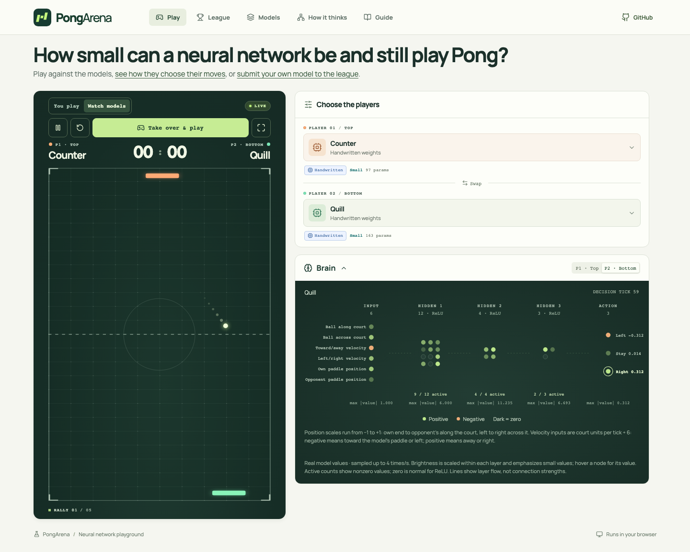

# PongArena

**How small can a neural network be and still play Pong?**

Play against tiny neural networks, watch them compete, and see their neurons fire as they make each move. Everything runs on your device in the browser with ONNX Runtime Web.

PongArena is open source. Submit your weights to enter the league.

[**Play in your browser**](https://jonaslindblom.github.io/pongarena/) · [Build a model](CONTRIBUTING.md) · [Game and model rules](docs/RULES.md)



## League models

The handwritten models encode their strategies directly in dense weights. The trained models start from random PyTorch weights: Small learns from scripted teachers, while Large adds reinforcement learning against scripts and past learned policies. Every model receives the same six observations and chooses from the same three actions.

| Model | How it is made | Layer widths | Parameters | MACs / decision |
| --- | --- | --- | ---: | ---: |
| [Follow](docs/FOLLOW.md) | Handwritten ball follower | `6 → 1 → 3` | 13 | 9 |
| [Predict](docs/PREDICT.md) | Handwritten landing and bounce prediction | `6 → 6 → 3 → 3` | 75 | 63 |
| [Attack](docs/ATTACK.md) | Handwritten prediction and opponent-aware corner aiming | `6 → 6 → 3 → 3` | 75 | 63 |
| [Counter](docs/COUNTER.md) | Handwritten prediction, corner aiming and center recovery | `6 → 6 → 4 → 3 → 3` | 97 | 81 |
| [Quill](docs/QUILL.md) | Handwritten prediction, recovery and aiming | `6 → 12 → 4 → 3 → 3` | 163 | 141 |
| [Small](training/README.md) | Trained with imitation learning | `6 → 16 → 6 → 3` | 235 | 210 |
| [Large](training/README.md) | Trained with imitation learning and PPO | `6 → 128 → 128 → 128 → 128 → 3` | 50,819 | 50,304 |
| [OneShot](experiments/one-prompt-weights/follow-up/README.md) | Prompted with game rules and a tactical brief | `6 → 12 → 4 → 3 → 3` | 163 | 141 |

All stored weights and biases count, including zeros. A MAC is a multiply-accumulate. Handwritten weights do not supply training labels, opponents or checkpoint-selection results for the learned models; they meet after the models are frozen. League results compare these particular controllers and serves; they do not establish performance against human players.

The project is inspired by [Sparks of Weight-Space Programming](https://rikiyat.github.io/blog/weight-space-programming/). Explore [Follow’s 13 parameters](https://jonaslindblom.github.io/pongarena/#how-it-thinks), or [switch off a Counter neuron](https://jonaslindblom.github.io/pongarena/#how-it-thinks/counter) to see how its decision changes. Both lessons run the actual ONNX weights and show their inputs, activations and moves.

**OneShot** uses 163 weights generated by Astra from the game rules and a tactical prompt. [Read the prompt and explore the model](https://jonaslindblom.github.io/pongarena/#how-it-thinks/oneshot), or [rebuild its exact weights and replay the results](experiments/one-prompt-weights/follow-up/README.md).

## Play and explore

- **Jump in:** the arena opens with Quill playing Counter and keeps rematching while untouched. Choose **Take over & play** to start a fresh game from the bottom paddle, with a three-second countdown. Interacting stops automatic rematches. Watch links autoplay their selected models; human match links wait for you to start.
- **Play:** choose an opponent, click the playing field, then move your mouse or trackpad left/right to steer without holding the button, even outside the field. Click outside the field or press **Esc** to release mouse control, or use **A/D** or **←/→** to take control. On a phone, hold either half of the court, slide across to change direction, and release to stop.
- **Watch models:** put two networks head to head. Open **Brain** to inspect their live activations.
- **Models:** inspect layer layouts, see linked submitters, download the exact ONNX files, or import your own locally.
- **League:** compare published standings or run a local tournament with imported models.

**P** starts, pauses, resumes or plays again. **R** restarts with the same serves. **F** toggles full screen; **Esc** exits it.

A match has five rallies at 30 decisions per second. Serves start at the center, alternate ends and use gentle, varied angles; returns build the difficulty. New matches draw fresh serves, while restart replays the current set for practice.

### Share a match or lesson

Arena links accept `?model=counter` to choose a human opponent, or
`?mode=watch&model=counter&opponent=quill` to watch two models.
Link directly to a tab with `#play`, `#league`, `#models`, `#how-it-thinks`,
or `#guide`. Use `#how-it-thinks/counter` or `#how-it-thinks/oneshot` to open a specific lesson.
Add `&fullscreen=1` to open the court in a viewport-filling layout. Watch links
start automatically; human match links wait for Play (or P). Model and fullscreen
changes update the URL for copying. Imported models are available only in browsers where they were saved;
unavailable linked models fall back to bundled models with a notice.
Human games show a three-second countdown before every serve.

## Run locally

Use **Node.js 22** and npm. Python is needed only for training or reconstructing weights.

```sh
git clone https://github.com/jonaslindblom/pongarena.git
cd pongarena
npm ci
npm run dev
```

Open the URL printed by Vite. To play from a phone on the same Wi-Fi, run `npm run dev -- --host 0.0.0.0` and open the printed Network URL.

```sh
npm run models:check  # validate ONNX graphs, budgets and finite WASM output
npm run typecheck     # check app, scripts and test types
npm test              # game, model and league checks
npm run league:check  # replay the checked-in development standings
npm run build         # production files in dist/
npm run preview       # serve the production build locally
```

Browser tests exercise the production app on desktop and mobile:

```sh
npx playwright install chromium
npm run test:e2e
```

## Submit a model

[Open a model PR](CONTRIBUTING.md) with an ONNX file, its roster entry and a reproducible constructor or training recipe. Model cards credit the submitter with a link to their GitHub profile.

The contract is float32 `observation [1, 6] → action_scores [1, 3]`, through one to five dense layers with uniform ReLU or Tanh hidden activations and a linear output. Files may be at most 256 KiB.

| Class | Maximum parameters | Maximum MACs / decision |
| --- | ---: | ---: |
| Small | 256 | 1,024 |
| Large | 65,536 | 65,536 |

Both limits apply. Small models can also enter Large. CI validates every submission’s graph, resource counts and runtime output before evaluation; see the [full contract](docs/RULES.md).

## How the league works

Published standings use **512 fresh shared serve sets**, drawn after model hashes are frozen. Every pair plays from both sides, for **28,672 games** with eight models. Retries reuse their saved serve plan. On merge, Pages publishes the verified results matching those exact models and rules.

A contest combines two five-rally games with swapped sides. A win earns one league point; a draw earns half. Approximate 95% score intervals resample whole serve sets, preserving both sides and all matchups together. Compare results within the same opponent field, rules and serve set.

The checked-in [development standings](public/league.md) use **16 fixed public serve sets / 896 games** for fast, reproducible checks. Run `npm run league` to regenerate them after changing the roster. They are separate from the larger published evaluation. Current rules are `pong-v3`. See [scoring and reproducibility](docs/RULES.md).

## Find your way around

- [Contributing](CONTRIBUTING.md): submit a model and run the PR checks.
- [Training](training/README.md): independent PyTorch recipes and evaluation.
- [Handwritten models](handwritten/README.md): rebuild Follow, Predict, Attack, Counter and Quill with NumPy and ONNX.
- [Rules](docs/RULES.md): observations, actions, physics, model limits and scoring.
- [Publishing](docs/PUBLISHING.md): GitHub Actions, required checks and Pages.
- [Screenshots](docs/media/README.md): refresh the README image from the running app.
- `src/`, `scripts/`, `tests/`, `e2e/`: the app, evaluators and automated checks.

## License

PongArena’s original source code, documentation and bundled ONNX model weights use the [MIT License](LICENSE). Contributions, including model submissions, are accepted under MIT. Third-party dependencies and assets retain their own licenses; their [notices](public/THIRD_PARTY_NOTICES.txt) ship with the website.
