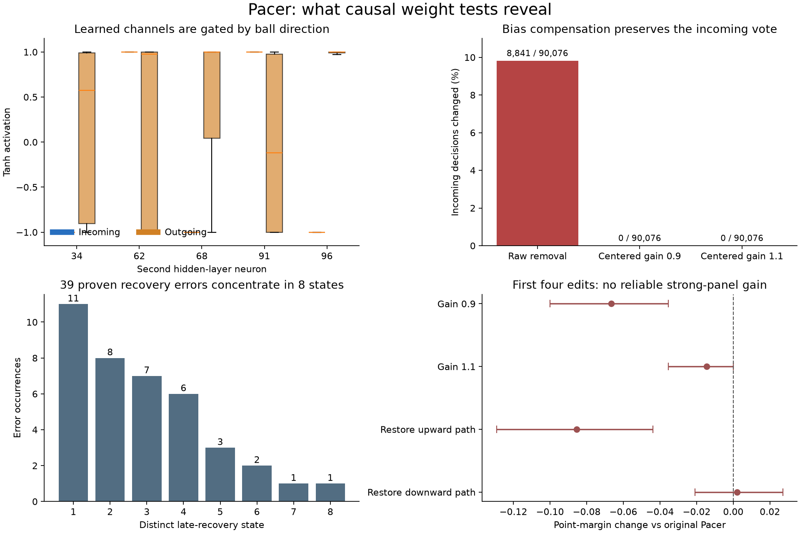

# Causal dense-weight study

Checkpoint status: **no demonstrated model upgrade in seven learned-weight interventions**. Local repairs do not establish an overall gain. Exploration continues with an independent compact dense approximation. These are development experiments, not new catalog standings.

All seven retained candidates are genuine `6→128→128→3` Tanh networks: three Gemm layers, two Tanh activations, 17,795 parameters and 17,536 MACs. They remain Standard class. There are no runtime geometric features, branches, trajectories, lookups, adapters or input/output changes. Geometry below diagnoses decisions offline; it is not exported. No formal training, parameter fitting, optimizer, gradient updates or random mutation search was used.

## What the weights mean, with causal evidence

The frozen source is Pacer, `training/results/pace-study/training/candidate/pacer/best.pt`, SHA-256 `57cd566fd8a0ddecb19dd2d20cce54a6bd1d18fb9784c37e5f5e2d8fd6790371`. Neuron indices are zero-based. First-layer rows are affine detectors; Tanh turns their biases into soft thresholds. Second-layer neurons combine those detectors. Differences between final output rows determine actions, rather than absolute output weights.

Some second-layer neurons have a nearly constant incoming activation and a variable outgoing activation. The important distinction is **conditional contribution**, not simply whether a neuron is saturated. Removing a saturated neuron removes its constant bias vote too.

For units `[34,62,68]`, the incoming constants are approximately `c=[−1,+1,−1]`. Scaling their outgoing contribution while retaining their incoming vote requires:

```
Wout[:, group] = gain * original_Wout[:, group]
bout += (1 - gain) * original_Wout[:, group] @ c
```

The score change is `(gain−1)·Wout·(h−c)`. On 176,501 fresh reachable observations, gains 0.9 and 1.1 leave **all 90,076 incoming actions unchanged**. Raw group removal changes 8,841 of those incoming actions. This is direct evidence that uncentered ablation confounds a context-dependent feature with its constant contribution.

The group is not a clean “correct recovery” module: its members have mixed downstream directional feedback. The modest gain edits do not repair any of the 39 proven late-recovery errors. A favorable hint for gain 1.1 in the earlier 19,012-state audit does not generalize to the fresh states or controlled grid.

Two aligned earlier checkpoints offer interpretable transfers. Unit 96 has a predominantly upward outgoing contribution; its round-24 row, bias and output column strengthen own-position feedback from −1.231 to −1.705 in normalized units. Unit 91 has a predominantly downward contribution; its round-18 path changes that feedback from −2.001 to −2.760. Donor rows evaluated on the **current** first layer retain outgoing activation correlations 0.9935 and 0.9861 to their original donor networks. Incoming constant-bias compensation again preserves all 90,076 incoming actions. The changed thresholds and votes still fail to improve matches. Local functional similarity is insufficient for a useful transfer.

## Where Pacer actually loses

The failure audit uses 24 fresh seeds against the actual adaptive attack and defense scripts, 240 rallies per pairing. Pacer scores 47/182/11 W/L/D against attack and 22/164/54 against defense.

Of 346 concessions, **341 are already uncatchable when the final incoming flight begins**. Five catchable misses occur at the contact tick. This points toward the preceding shot and recovery choices, rather than generic last-flight interception changes.

There are **39 proven recovery-option losses in eight distinct outgoing states**. A safe region for every legal opponent return was reachable after Pacer's own shot, but its later action discards that option 1–2 ticks before opponent contact. These are conservative counterfactual proofs, independent of how the opponent adapts. Other concessions often have no such universally safe option.

A different single contact-tick action reduces positive geometric recovery risk in 232 concessions, including 111 where that risk becomes nonpositive. That is a diagnostic opportunity, not a claim that those rallies would be won. Following the attacker teacher does not resolve every case: the teacher itself often accepts positive recovery risk.

Verification checks 1,132,626 discrete reachability cases against the existing contact-path calculation and 8,203 native ONNX observations against the source network. See `failure-audit/verification.json`.

## Seven explicit interventions and every outcome

The four initial candidates were fixed from the feature audit before their match panel. The fifth follows the late-recovery diagnosis: unit 89 is near +1 on incoming states and −1 on the targeted outgoing states. Two numerical edits add a phase-selective stay vote:

```
Wout[stay, 89] -= 0.5
bout[stay] += 0.5
# delta_stay = 0.5 * (1 - h89)
```

This leaves all 90,076 incoming actions unchanged and changes 6,886/86,425 outgoing actions. It repairs the two selected outgoing states covering 19 safety-error occurrences, but also stops necessary movement elsewhere.

| Fixed candidate | Attack W/L/D | Defense W/L/D | Pacer W/L/D | Strong-panel margin change, 95% interval |
| --- | ---: | ---: | ---: | ---: |
| Centered gain 0.9 | 38/197/5 | 18/168/54 | 110/125/5 | −0.0667 [−0.1000, −0.0354] |
| Centered gain 1.1 | 44/185/11 | 22/165/53 | 117/117/6 | −0.0146 [−0.0354, 0.0000] |
| Restore upward path 96 | 29/200/11 | 23/170/47 | 106/129/5 | −0.0854 [−0.1292, −0.0438] |
| Restore downward path 91 | 44/184/12 | 25/161/54 | 112/120/8 | +0.0021 [−0.0208, +0.0271] |
| Phase braking 89 | 47/192/1 | 22/147/71 | 123/111/6 | +0.0146 [−0.0313, +0.0583] |
| Remove centered down vote 68 | 32/208/0 | 25/161/54 | 108/125/7 | −0.0729 [−0.1104, −0.0354] |
| Neutralize motion permission 56 | 53/180/7 | 18/155/67 | 109/128/3 | +0.0271 [−0.0438, +0.1042] |

The sixth edit removes only unit 68's centered down vote: set `Wout[down,68]=0` and subtract its old value from `bout[down]`. Its fixed-observation footprint is much narrower than the broad brake: 0 incoming and 2,391 outgoing actions change. It repairs the same 19 retained safety errors, and no retained flip immediately discards a universal safety option. Nevertheless, 430/480 rallies diverge, typically 18 ticks before contact; full games get worse. An unchanged incoming mapping does not preserve incoming behavior once different recovery actions change later paddle positions and opponent replies. Local proofs do not establish global feature value.

The seventh edit follows an independent contact analysis. Unit 56 contributes mainly permission to move: its output stay-versus-mean-move contrast is −0.58303, while its down-versus-up contrast is only +0.08135. Set its stay weight to the mean of its up/down weights and add that weight difference to the stay bias. This source-derived two-number edit preserves the saturated −1 reference and up/down steering. On the original 2,214 own contacts it improves geometric risk 135 times, worsens it 30 times and creates no immediate misses. Most improvements (117/135) make the shot steeper: staying near the previous paddle position can be safer than chasing a centered contact. Low-speed cases trade against high-speed gains. The full-game improvement interval still spans zero, so this is not promoted.

Six unchanged earlier source checkpoints are additional controls in `checkpoint-audit/game-controls.json`. All are weaker than final Pacer on this strong panel. The closest, continuation round 18, has a margin change −0.0563 [−0.1542, +0.0521]. Round 12 narrowly beats final Pacer head-to-head (116/101/23) while losing badly to both scripts, illustrating nontransitivity. Several earlier checkpoints repair the same retained safety examples yet play substantially worse overall. A local repair is not evidence of a generally healthier source network.

The strong panel is the equal-weight mean paired-seed point-margin change against attack and defense. Each seed retains both physical sides and all five rallies; 4,000 whole-seed bootstrap resamples give descriptive intervals. There are also full panels against Apprentice, Contender and Tracker in `development/`. These are development comparisons of adaptively explored hypotheses, not confirmatory p-values. No final holdout has been consumed because none qualifies.

## Reproduction and evidence

`training/scripts/causal_dense_edits.py --out <fresh-directory>` recreates all seven exact candidates from frozen source weights and runs the strict active dense validator. `validation.json` records hashes, architecture, resource counts and exactly which parameters changed. `native-verification.json` records zero action mismatches on 8,192 fresh observations per candidate (57,344 total). Maximum score differences are about 1.1e−5.

`failure-audit/pacer-failure-states.npz` retains the 176,501 observations and contextual labels. `critical-states.npz` retains the 11 distinct incoming/outgoing actionable states. `checkpoint-audit/` and `feature-audit/` contain attribution, controlled interventions and donor-path checks. `source/` preserves the original research scripts with their temporary paths; the 234 MB activation cache and duplicate observation array are omitted because they can be regenerated. The portable candidate constructor is the maintained reproduction entry point.


